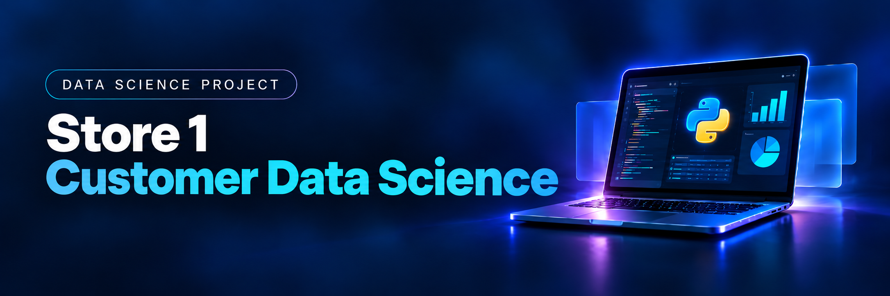

# Store 1 | Customer Data Science

**Customer Data Preparation & Business Analytics**

---

## 🔎 Explore the Project | Explora el proyecto

**🚧 Status: In Preparation | Estado: En preparación**

This project is being prepared as part of my Data Science portfolio. The notebooks, results, and conclusions will be added as the analysis is completed.

Este proyecto se está preparando como parte de mi portafolio de Ciencia de Datos. Los notebooks, resultados y conclusiones se incorporarán conforme se complete el análisis.

| Project Component / Componente | Description / Descripción | Access / Acceso |
|---|---|---|
| **01 · Data Preparation** | Customer data cleaning, standardization and validation / Limpieza, estandarización y validación de datos | ⏳ Coming soon |
| **02 · Customer Analysis** | Customer behavior and business analysis / Análisis de clientes y negocio | ⏳ Coming soon |

**Note:** Direct links to the Jupyter notebooks will be available once each phase is completed.

**Nota:** Los enlaces directos a los notebooks estarán disponibles cuando finalice cada fase.

---

## 🌎 Project Overview | Descripción del proyecto

| 🇺🇸 English | 🇲🇽 Español |
|---|---|
| **Store 1** is an e-commerce company preparing the launch of a customer loyalty program. The company needs reliable and organized customer information to develop personalized marketing strategies and support business decisions. | **Store 1** es una empresa de comercio electrónico que prepara el lanzamiento de un programa de fidelización. La empresa necesita información confiable y organizada sobre sus clientes para desarrollar estrategias de marketing personalizadas y apoyar la toma de decisiones. |

### Business Challenge | Problema de negocio

**EN:** Customer data must be cleaned, standardized and validated before it can be used for meaningful analysis.

**ES:** Los datos de clientes deben limpiarse, estandarizarse y validarse antes de utilizarlos para realizar un análisis confiable.

---

## 🎯 Project Objectives | Objetivos

| Objective / Objetivo | Description / Descripción |
|---|---|
| **Data Cleaning / Limpieza** | Correct inconsistencies in customer records / Corregir inconsistencias en los registros |
| **Standardization / Estandarización** | Standardize customer names and ages / Estandarizar nombres y edades |
| **Spending Analysis / Análisis de gastos** | Calculate total spending per customer / Calcular el gasto total por cliente |
| **Data Validation / Validación** | Review and validate data consistency / Revisar y validar la consistencia de los datos |
| **Business Insights / Hallazgos** | Prepare information to support marketing decisions / Preparar información para decisiones de marketing |

---

## ⚙️ Approach | Metodología

The project is organized into two connected phases.

El proyecto se organiza en dos fases relacionadas.

**01 · Data Preparation | Preparación de datos**

- Review customer information / Revisar los datos de clientes
- Clean and standardize records / Limpiar y estandarizar registros
- Calculate customer spending / Calcular gastos por cliente
- Validate the prepared information / Validar la información preparada

**02 · Customer Analysis | Análisis de clientes**

- Analyze the prepared data / Analizar los datos preparados
- Explore purchasing patterns / Explorar patrones de compra
- Develop business insights / Desarrollar hallazgos de negocio

*The methodology will be updated to reflect the work actually performed.*

*La metodología se actualizará para reflejar el trabajo realmente realizado.*

---

## 📈 Results & Business Insights | Resultados y hallazgos

**⏳ Coming Soon | Próximamente**

**EN:** This section will present the actual results, relevant findings, and business conclusions once the analysis is completed.

**ES:** Esta sección presentará los resultados reales, los hallazgos relevantes y las conclusiones de negocio cuando finalice el análisis.

---

## 💡 Key Learnings | Aprendizajes

**⏳ Coming Soon | Próximamente**

**EN:** Technical challenges, solutions, and lessons learned will be documented here.

**ES:** Aquí se documentarán los desafíos técnicos, las soluciones y los aprendizajes obtenidos durante el proyecto.

---

## 🤝 Connect | Contacto

**Abner Álvarez Cabrera**

Industrial Engineer | Data Science & Analytics

---

  <i>From Data to Better Decisions</i>

  <i>From Data to Better Decisions</i>

