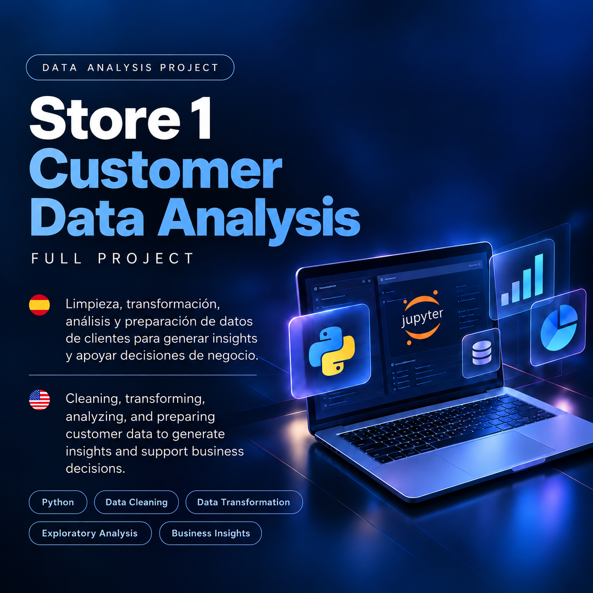

# 📊 Store 1 — Customer Analytics

### Customer Data Preparation & Business Analysis
**Data Science Portfolio | Project 01**

**🚧 Status: In Development | Estado: En desarrollo**

---

<!-- PORTADA: activar esta línea cuando subamos images/cover.png -->
<!--  -->

## 🌎 Project Overview | Descripción del proyecto

| 🇺🇸 English | 🇲🇽 Español |
|---|---|
| Store 1 is an e-commerce company preparing a customer loyalty program. This project focuses on cleaning, transforming, and analyzing customer data to support personalized marketing and data-driven business decisions. | Store 1 es una empresa de comercio electrónico que prepara un programa de fidelización. Este proyecto se enfoca en limpiar, transformar y analizar datos de clientes para apoyar campañas personalizadas y decisiones de negocio basadas en datos. |

---

## 🎯 Project Objectives | Objetivos

| 🇺🇸 Objectives | 🇲🇽 Objetivos |
|---|---|
| Clean customer profiles | Limpiar perfiles de clientes |
| Standardize names and ages | Estandarizar nombres y edades |
| Calculate total spending per customer | Calcular el gasto total por cliente |
| Validate data consistency | Validar la consistencia de los datos |
| Prepare information for business KPIs | Preparar información para indicadores de negocio |

---

## 🗺️ Project Roadmap | Etapas

| Phase | Description | Status |
|---|---|---|
| **01 — Data Preparation** | Customer data cleaning, standardization and validation | ⏳ Pending |
| **02 — Customer Analysis** | Analysis of prepared customer data and business insights | ⏳ Pending |

### Phase 01 | Fase 01

**Data Preparation / Preparación de datos**

Prepare a customer dataset by cleaning and standardizing its information.

Preparar los datos de clientes mediante procesos de limpieza y estandarización.

### Phase 02 | Fase 02

**Customer Analysis / Análisis de clientes**

Analyze the prepared information to answer business questions.

Analizar la información preparada para responder preguntas de negocio.

---

## 🛠️ Technologies | Tecnologías

| Technology | Purpose |
|---|---|
| 🐍 Python | Data manipulation and processing |
| 📓 Jupyter Notebook | Interactive code and documentation |
| 🐙 GitHub | Version control and project presentation |

---

## ⚙️ Workflow | Proceso

**Data Preparation → Data Validation → Customer Analysis → Business Insights**

**Preparación de datos → Validación → Análisis de clientes → Hallazgos de negocio**

---

## 📁 Project Structure | Estructura del proyecto

Planned structure / Estructura prevista:

    store1-customer-analytics/
    │
    ├── images/
    │   └── cover.png
    │
    ├── notebooks/
    │   ├── 01_data_preparation.ipynb
    │   └── 02_customer_analysis.ipynb
    │
    └── README.md

The notebooks will be added as the project progresses.

Los notebooks se incorporarán conforme avance el proyecto.

---

## 📈 Results & Insights | Resultados y hallazgos

**⏳ Coming Soon | Próximamente**

🇺🇸 This section will present actual results, relevant findings, and business conclusions after the analysis is completed.

🇲🇽 Esta sección presentará los resultados reales, hallazgos relevantes y conclusiones de negocio cuando finalice el análisis.

---

## 💡 Key Learnings | Aprendizajes

**Coming soon | Próximamente**

Technical challenges, solutions, and lessons learned will be documented here.

Aquí se documentarán los desafíos técnicos, las soluciones y los aprendizajes del proyecto.

---

## 🤝 Connect | Contacto

**Abner Álvarez Cabrera**

Industrial Engineer | Data Science & Analytics

---

  <i>From Data to Better Decisions</i>

---

